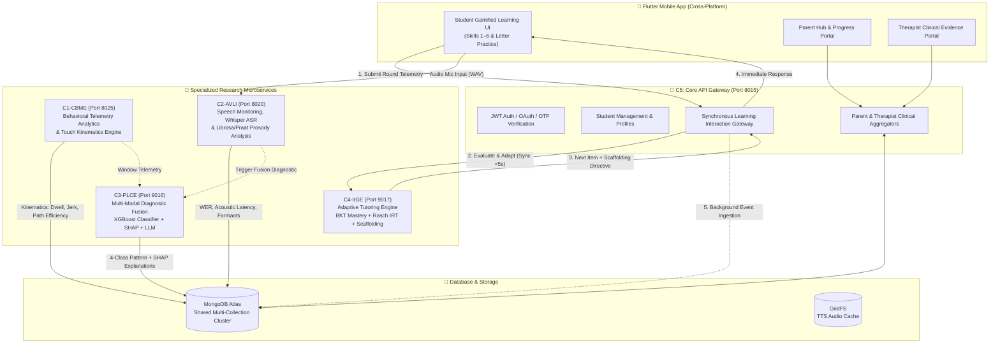

# Sipsara (සිප්සර) — AI-Powered Adaptive Learning & Early Diagnostic Screening System

[](https://flutter.dev)
[](https://fastapi.tiangolo.com)
[](https://www.python.org/)
[](https://www.mongodb.com/)
[](https://pytorch.org/)
[](https://xgboost.ai/)
[](https://huggingface.co/)

> **Research Project Identifier:** `R26-SE-031`  
> **Academic Focus:** Adaptive Gamified Learning, Touch Telemetry Kinematics, Acoustic-Prosodic Speech Analysis, Multi-Modal Diagnostic Fusion, and Explainable AI for Grade 1 Sinhala Early Reading Difficulties.

---

## 📖 Table of Contents
1. [Executive Summary](#-executive-summary)
2. [System Architecture](#-system-architecture)
3. [The 4 Main Research Components (+ C5 Gateway)](#-the-4-main-research-components)
   - [C1 — Cognitive & Behavioral Monitoring Engine (CBME)](#1-component-1-c1---cognitive--behavioral-monitoring-engine-cbme)
   - [C2 — Audio-Visual Linguistic Interface (AVLI)](#2-component-2-c2---audio-visual-linguistic-interface-avli)
   - [C3 — Personalized Learning Classification Engine (PLCE)](#3-component-3-c3---personalized-learning-classification-engine-plce)
   - [C4 — Intelligent Instructional Guidance Engine (IIGE)](#4-component-4-c4---intelligent-instructional-guidance-engine-iige)
   - [C5 — Auth, Student & Clinical Gateway Service](#5-component-5-c5---core-api--auth-service)
4. [Student Skills & Activities Catalogue](#-student-skills--activities-catalogue)
   - [Skill 1: Visual Picture Recognition (`පින්තූර හඳුනාගනිමු`)](#skill-1--visual-picture-recognition-පින්තූර-හඳුනාගනිමු)
   - [Skill 2: Basic Letter Recognition (`මූලික අකුරු හඳුනාගනිමු`)](#skill-2--basic-letter-recognition-මූලික-අකුරු-හඳුනාගනිමු)
   - [Skill 3: Simple Word Building (`සරල වචන සකසමු`)](#skill-3--simple-word-building-සරල-වචන-සකසමු)
   - [Skill 4: Simple Sentence Building (`සරල වාක්‍ය සකසමු`)](#skill-4--simple-sentence-building-සරල-වාක්‍ය-සකසමු)
   - [Skill 5 & 6: Oral Reading Comprehension & Sinhala Textbook](#skills-5--6--oral-reading-comprehension--sinhala-textbook)
   - [Bonus Letter Practice: Sinhala Vowels & Consonants](#bonus-letter-practice--sinhala-vowels--consonants)
5. [Telemetry & Parameters Captured Per Activity](#-telemetry--parameters-captured-per-activity)
6. [Machine Learning & Algorithmic Models Matrix](#-machine-learning--algorithmic-models-matrix)
7. [Data Persistence (MongoDB Collections Schema)](#-data-persistence-mongodb-collections-schema)
8. [Microservices & Port Configuration](#-microservices--port-configuration)
9. [Key API Endpoints Reference](#-key-api-endpoints-reference)
10. [Frontend Mobile Application Structure](#-frontend-mobile-application-structure)
11. [Installation & Local Execution Guide](#-installation--local-execution-guide)

---

## 🌟 Executive Summary

**Sipsara** is an AI-powered adaptive educational and early diagnostic platform specifically engineered for **Grade 1 primary students learning to read and write Sinhala**. Early detection of developmental reading difficulties (such as phonological processing deficits, visual-orthographic decoding delays, and attention/motor hesitation) is critical to prevent long-term academic underachievement.

Sipsara bridges this gap through a unified multi-stakeholder ecosystem:
- **Child / Student Experience:** A gamified, character-driven mobile application featuring interactive touch minigames, audio prompts, and speech recognition tasks mapped to national curriculum standards.
- **Parent Portal:** Real-time visibility into learning progress, engagement time, mastery trajectories, and guided home practice recommendations.
- **Specialist / Therapist Portal:** Clinical-grade diagnostic transparency featuring multi-modal evidence inspection, granular touch telemetry, acoustic speech analysis, XGBoost learning pattern classifications with SHAP feature attributions, and Gemini LLM-driven clinical narratives.

---

## 🏗 System Architecture

The platform operates on a distributed microservice architecture where client interactions from the Flutter mobile application are asynchronously and synchronously ingested, analyzed, and adapted.



---

## 🔬 The 4 Main Research Components

### 1. Component 1: C1 - Cognitive & Behavioral Monitoring Engine (CBME)
* **Directory:** [`app/backend/telemetry-analytics-v1`](file:///d:/01%20ACADEMIA/4th%20Year/Y4.S2/RP-IT4010/00%20-%20Implementation/R26-SE-031/app/backend/telemetry-analytics-v1) | **Port:** `8025`
* **Role & Research Objective:** Unobtrusively extracts real-time non-verbal behavioral signatures and touch dynamics during child-game interactions to quantify attention, motor control, hesitation, and cognitive processing loads.
* **Core Mechanisms & Pipeline:**
  - **Fine-Grained Touch Kinematics:** Computes spatial directness (*Path Efficiency Ratio*), gesture smoothness (*Dimensionless Jerk* via acceleration derivatives), and finger contact duration (*Dwell Time*).
  - **Behavioral Telemetry Extraction:** Quantifies hesitation counts (hover events exceeding child baseline thresholds), misclick frequencies, audio replay requests, and response latencies.
  - **Fatigue & Session Modeling:** Calculates rolling cognitive fatigue proxies based on session duration, latency drift, and error escalation to recommend timely rest breaks.
* **Key Outputs:** Session behavioral summaries, task-specific speed indices (`c1_visual_task_index`, `c1_sound_task_index`), and rolling feature vectors fed directly to C3 Diagnostic Fusion.

---

### 2. Component 2: C2 - Audio-Visual Linguistic Interface (AVLI)
* **Directory:** [`app/backend/speech-monitoring-v1`](file:///d:/01%20ACADEMIA/4th%20Year/Y4.S2/RP-IT4010/00%20-%20Implementation/R26-SE-031/app/backend/speech-monitoring-v1) | **Port:** `8020`
* **Role & Research Objective:** Analyzes oral reading fluency, letter articulation, and spoken word decoding in the native Sinhala language using Automatic Speech Recognition (ASR) coupled with acoustic-prosodic digital signal processing.
* **Core Mechanisms & Pipeline:**
  - **Fine-Tuned Sinhala Speech-to-Text (ASR):** Leverages OpenAI Whisper (Transformers architecture) fine-tuned for Sinhala phonetic decoding to compute Word Error Rate (WER) and Grapheme Error Rate (GER) via Levenshtein edit distance alignment.
  - **Syllabic Rhythm & Peak Detection (`Librosa`):** Extracts energy envelope peaks to identify syllabic beat patterns, syllabic mismatch metrics, and speaking rate (Words Per Minute / WPM).
  - **Acoustic-Prosodic Profiling (`Parselmouth / Praat`):** Measures acoustic latency (voice onset time from visual stimulus), intra-word silence ratios, pitch instability (*Local Jitter*), and amplitude perturbation (*Local Shimmer*).
  - **Speech Synthesis (TTS):** Generates native Sinhala instructional prompts and letter pronunciations via `gTTS` with GridFS binary caching.
* **Key Outputs:** Quantitative oral reading fluency vectors, articulation confidence scores, and acoustic biomarker evidence for therapist diagnostics.

---

### 3. Component 3: C3 - Personalized Learning Classification Engine (PLCE)
* **Directory:** [`app/backend/diagnostic-fusion-v1`](file:///d:/01%20ACADEMIA/4th%20Year/Y4.S2/RP-IT4010/00%20-%20Implementation/R26-SE-031/app/backend/diagnostic-fusion-v1) | **Port:** `9016`
* **Role & Research Objective:** Aggregates multi-modal behavioral, kinematic, speech, and demographic data across a 14-day rolling window to classify students into clinical learning profiles and deliver transparent, explainable insights.
* **Core Models & Explainability:**
  - **Multi-Class Classifier:** Gradient boosted decision trees (**XGBoost**, model `c3-learner-window-v3`) trained on 14 fused features spanning C1 touch kinematics, C2 speech prosody, and student profile attributes.
  - **4 Distinct Learning Pattern Classifications:**
    1. `Typical Learning Pattern` (Class 0): Normal developmental milestones with balanced processing.
    2. `Phonological Learning Pattern` (Class 1): Difficulties with sound-letter decoding, acoustic latency, and pronunciation fluency.
    3. `Visual-Orthographic Learning Pattern` (Class 2): Spatial pattern recognition delays, shape-matching struggles, and high touch jerk.
    4. `Combined Learning Pattern` (Class 3): Co-occurring challenges across both phonological and visual-orthographic domains.
  - **Explainable AI (SHAP):** Uses `TreeExplainer` to generate local feature importance values, exposing exactly *why* a child received a given classification in human-readable terms.
  - **LLM Clinical Narrator (Google Gemini `google-genai`):** Converts complex numerical features and SHAP values into professional clinical diagnostic reports and powers an interactive therapist Q&A assistant (`/diagnose/chat`).

---

### 4. Component 4: C4 - Intelligent Instructional Guidance Engine (IIGE)
* **Directory:** [`app/backend/adaptive-tutoring-v1`](file:///d:/01%20ACADEMIA/4th%20Year/Y4.S2/RP-IT4010/00%20-%20Implementation/R26-SE-031/app/backend/adaptive-tutoring-v1) | **Port:** `9017`
* **Role & Research Objective:** Orchestrates real-time pedagogical adaptation, tracking individual Knowledge Component (KC) mastery and dynamically calibrating task selection, item difficulty, and multi-tier scaffolding.
* **Core Models & Adaptive Policies:**
  - **Bayesian Knowledge Tracing (4-Parameter BKT):** Continuously estimates latent mastery probability $P(L_t)$ per Knowledge Component using prior mastery $P(L_0)$, learning transition $P(T)$, guess probability $P(G)$, and slip probability $P(S)$.
  - **Item Response Theory (1-PL Rasch Model):** Dynamically estimates child ability ($\theta$) in logits against calibrated item bank difficulties ($b$).
  - **Deterministic Equivalent-Task Policy:** Enforces a robust pedagogy flow:
    $$\text{Core Item} \xrightarrow{\text{Struggle / Fail}} \text{V1 Remediation (Lower Load)} \xrightarrow{} \text{V2 Confirmation (Standard Load)} \xrightarrow{} \text{Next Unseen Core}$$
    *(Prevents infinite retry loops, ensures child never repeats identical failed content, and maintains stable progression dots).*
  - **Dynamic Multi-Tier Scaffolding Engine:** Classifies student response quality into `CLEAN_SUCCESS`, `ASSISTED_SUCCESS`, `STRUGGLED_SUCCESS`, or `FAILED`. Provides progressive runtime assistance (visual highlighting, distractor pruning, auditory clues).
  - **Machine Learning Action Policy (Shadow Mode):** Evaluates predictive scaffolding actions alongside deterministic rules.

---

### 5. Component 5: C5 - Core API & Auth Service
* **Directory:** [`app/backend/api`](file:///d:/01%20ACADEMIA/4th%20Year/Y4.S2/RP-IT4010/00%20-%20Implementation/R26-SE-031/app/backend/api) | **Port:** `8015`
* **Role:** Central gateway managing security, identity, student profiles, parent/therapist portals, and the synchronous `/api/v1/learning/interaction` pipeline that coordinates C4, C1, and C2.

---

## 📚 Student Skills & Activities Catalogue

Sipsara structures early Sinhala literacy into **6 primary curriculum skills**, each consisting of specialized interactive mini-games and calibrated Knowledge Components (KCs), supplemented by dedicated **Letter Practice modules**.

### Skill 1 — Visual Picture Recognition (`පින්තූර හඳුනාගනිමු`)
> **Curriculum Domain:** Visual Discrimination, Visual Memory & Categorization  
> **Target Audience:** Pre-reading & early visual processing development

| Activity ID | Sinhala Activity Title | English Title | Interaction Mechanic | What the Student Does | Knowledge Component (KC) |
|---|---|---|---|---|---|
| `1.1` | **සැඟවුණු පින්තූර සොයමු** | Find the Hidden Picture | Hidden Object Search | Scans a visually detailed scene and taps hidden target objects | `KC_VISUAL_IDENTIFICATION` |
| `1.2` | **සෙවනැල්ලට පින්තූරය ගළපමු** | Match Picture to Shadow | Silhouette Matching | Matches a solid black silhouette outline to the matching coloured object | `KC_VISUAL_MATCHING` |
| `1.3` | **පින්තූර වෙන් කරමු** | Sort the Pictures | Drag-and-Drop Categorization | Drags items (animals, vehicles, foods) into their correct category buckets | `KC_VISUAL_CATEGORIZATION` |
| `1.4` | **රටාව සම්පූර්ණ කරමු** | Complete the Pattern | Sequence Pattern Completion | Identifies the repeating visual pattern and selects the next correct item | `KC_VISUAL_PATTERN` |
| `1.5` | **පින්තූර මතකයෙන් සොයමු** | Memory Hat Card Search | Visual Working Memory | Observes items briefly shown under magical hats, then recalls and taps them | `KC_VISUAL_MEMORY` |

---

### Skill 2 — Basic Letter Recognition (`මූලික අකුරු හඳුනාගනිමු`)
> **Curriculum Domain:** Orthographic Processing, Letter Discrimination & Grapheme-Phoneme Mapping  
> **Target Audience:** Early Sinhala alphabet acquisition

| Activity ID | Sinhala Activity Title | English Title | Interaction Mechanic | What the Student Does | Knowledge Component (KC) |
|---|---|---|---|---|---|
| `2.1` | **නිවැරදි අකුර සොයමු** | Odd One Out | Visual Letter Discrimination | Identifies and taps the Sinhala letter that does not belong in the group | `KC_LETTER_IDENTIFICATION` |
| `2.2` | **සමාන අකුරු සොයමු** | Find Identical Letters | Pair Matching Grid | Finds and selects matching pairs of identical Sinhala characters | `KC_LETTER_MATCHING` |
| `2.3` | **අකුර අසා හඳුනා ගනිමු** | Listen & Select Letter | Auditory-Phonetic MCQ | Hears a spoken Sinhala letter sound and selects the matching written character | `KC_PHONEME_LETTER_MAPPING` |
| `2.4` | **අකුර සොයා තෝරමු** | Target Letter Search | Rapid Letter Selection | Taps the target letter among multiple visual distractors | `KC_LETTER_DECODING` |
| `2.5` | **අකුරු මතකයෙන් සකසමු** | Pattern Letter Memory | Sequential Working Memory | Memorizes an animated sequence of letters and taps them in the identical order | `KC_LETTER_MEMORY` |

---

### Skill 3 — Simple Word Building (`සරල වචන සකසමු`)
> **Curriculum Domain:** Morphological Assembly, Syllable Blending & Orthographic Synthesis  
> **Target Audience:** Transitioning from individual letters to two- and three-letter words

| Activity ID | Sinhala Activity Title | English Title | Interaction Mechanic | What the Student Does | Knowledge Component (KC) |
|---|---|---|---|---|---|
| `3.1` | **පින්තූරයට වචනය තෝරමු** | Choose Word for Picture | Image-to-Word Association | Observes a clear picture and taps the correct written Sinhala word | `KC_WORD_RECOGNITION` |
| `3.2` | **අකුරුවලින් වචන හදමු** | Build Words from Letters | Akshara Assembly MCQ | Assembles given individual letters/vowel strokes to form the target word | `KC_WORD_FORMATION` |
| `3.3` | **වචන අසා හඳුනා ගනිමු** | Listen & Identify Word | Auditory Word MCQ | Listens to a clear native audio pronunciation and selects the matching word | `KC_AUDITORY_WORD_RECOGNITION` |
| `3.4` | **අඩු අකුර සොයමු** | Find the Missing Letter | Fill-in-the-Blank | Identifies the missing akshara or vowel sign to complete an incomplete word | `KC_WORD_COMPLETION` |
| `3.5` | **අකුරු පිළිවෙළට සකසමු** | Arrange Letters in Order | Jumbled Letter Unscrambler | Taps or drags scrambled letters into the correct sequential order to form a word | `KC_WORD_SEQUENCING` |

---

### Skill 4 — Simple Sentence Building (`සරල වාක්‍ය සකසමු`)
> **Curriculum Domain:** Syntax Comprehension, Sentence Structure & Sequential Context  
> **Target Audience:** Forming and reading basic 3- to 4-word Sinhala sentences

| Activity ID | Sinhala Activity Title | English Title | Interaction Mechanic | What the Student Does | Knowledge Component (KC) |
|---|---|---|---|---|---|
| `4.1` | **පින්තූරයට වාක්‍යය තෝරමු** | Match Sentence to Picture | Picture-Sentence MCQ | Evaluates an illustration and chooses the sentence that correctly describes it | `KC_SENTENCE_COMPREHENSION` |
| `4.2` | **වචන යොදා වාක්‍ය හදමු** | Sentence Fill-in-the-Blank | Cloze Word Selection | Selects the grammatically appropriate word to complete an incomplete sentence | `KC_SENTENCE_COMPLETION` |
| `4.3` | **වාක්‍ය අසා හඳුනා ගනිමු** | Listen & Select Sentence | Auditory Sentence MCQ | Hears a spoken sentence and identifies the matching written sentence | `KC_AUDITORY_SENTENCE_RECOGNITION` |
| `4.4` | **වචන පිළිවෙළට සකසමු** | Arrange Words in Order | Jumbled Sentence Unscrambler | Drags scrambled words into correct Subject-Object-Verb (SOV) grammatical order | `KC_SENTENCE_SEQUENCING` |

---

### Skills 5 & 6 — Oral Reading Comprehension & Sinhala Textbook
> **Curriculum Domain:** Oral Reading Fluency, Pronunciation & Textual Comprehension  
> **Powered by:** Component 2 (Whisper STT & Acoustic Prosodic Analysis)

| Skill / ID | Sinhala Activity Title | English Title | Modality | What the Student Does |
|---|---|---|---|---|
| **Skill 5** | **කියවා තේරුම් ගනිමු** | Read & Understand | Oral Reading + MCQ | Reads short stories aloud; answers comprehension questions |
| `5.1` | කියවා කරන්න | Read Aloud & Do | Mic Recording | Reads a prompt sentence aloud into the device microphone |
| `5.2` | කවුද? | Who is it? | Context MCQ | Answers "Who" comprehension questions based on read text |
| `5.3` | මොනවාද? | What is it? | Context MCQ | Answers "What" questions based on passage objects/actions |
| `5.4` | කොහෙද? | Where is it? | Context MCQ | Answers "Where" spatial comprehension questions |
| **Skill 6** | **සිංහල පෙළපොත** | Sinhala Textbook Reading | Oral Reading Fluency | Reads official Grade 1 Sinhala curriculum textbook passages aloud |
| `6.1` | පෙළපොතෙන් කියවමු - 1 | Textbook Passage 1 | Mic Recording | Reads Passage 1 aloud; evaluated for WPM, WER, and pauses |
| `6.2` | පෙළපොතෙන් කියවමු - 2 | Textbook Passage 2 | Mic Recording | Reads Passage 2 aloud; evaluated for prosody, jitter, and shimmer |

---

### Bonus Letter Practice — Sinhala Vowels & Consonants
> **Curriculum Domain:** Isolated Phoneme Articulation & Audio-Visual Reinforcement

| Practice Code | Sinhala Title | Category | Letter Coverage |
|---|---|---|---|
| `skill_sinhala_vowels` | **ස්වර අකුරු (පණ අකුරු)** | Vowels (Pana Akuru) | **12 Primary Vowels:** අ, ආ, ඇ, ඈ, ඉ, ඊ, උ, ඌ, එ, ඒ, ඔ, ඕ |
| `skill_sinhala_consonants` | **ව්‍යංජන අකුරු (ගත අකුරු)** | Consonants (Gatha Akuru) | **18 Foundational Consonants:** ක, ග, ච, ජ, ට, ඩ, ත, ද, න, ප, බ, ම, ය, ර, ල, ව, ස, හ |

---

## 📊 Telemetry & Parameters Captured Per Activity

Every interactive session captures rich multi-dimensional parameters across interaction, kinematic, and speech layers:

### 1. Core Behavioral Telemetry
* `first_touch_latency_ms`: Elapsed time from stimulus onset to child's initial screen touch.
* `total_round_latency_ms`: Total completion time for the task round.
* `time_to_first_response_ms`: Latency until first option selection attempt.
* `time_to_correct_ms`: Total elapsed time until the correct answer is resolved.
* `hesitation_count`: Number of touch-hover/pause events (threshold calibrated for Grade 1 children).
* `misclick_count`: Number of touches outside actionable target zones.
* `audio_replay_count`: Frequency of child manually requesting audio instruction replay.
* `attempt_count` / `incorrect_attempt_count`: Number of tries before reaching final response.
* `first_attempt_correct`: Boolean flag indicating whether the initial attempt was successful.
* `correction_count`: Number of times the child altered their selected choice.
* `hint_count`: Frequency of explicit hint requests.
* `scaffold_level_used`: Scaffolding depth (0 = None, 1 = Visual highlight, 2 = Distractor pruned, 3 = Full audio cue).
* `is_abandoned`: Flag indicating whether the round was exited without completion.

### 2. Fine-Grained Kinematics (Touch Movement)
* `path_efficiency_ratio`: Ratio of the straight-line Euclidean distance to the actual finger drag trajectory length.
* `dimensionless_jerk`: Derivative of acceleration normalized by movement duration (quantifies motor smoothness).
* `dwell_time_ms`: Duration the child's fingertip maintains continuous contact with the glass during a tap/drag.
* `touch_stream`: Timestamped array of `(x, y, timestamp, pressure)` raw touch coordinates.

### 3. Speech & Acoustic Metrics (C2 Oral Reading)
* `word_error_rate` (WER): Word-level Levenshtein error against expected Sinhala text.
* `grapheme_error_rate` (GER): Character-level phoneme decoding error rate.
* `asr_confidence`: Mean token confidence score from the Whisper ASR decoder.
* `acoustic_latency_ms`: Latency from visual text prompt display to vocal speech onset.
* `voice_onset_ms`: Absolute acoustic onset detected via energy envelope analysis.
* `detected_peaks`: Number of syllabic acoustic energy peaks detected by Librosa.
* `syllabic_event_mismatch`: Absolute difference $| \text{detected peaks} - \text{expected syllables} |$.
* `intra_word_silence_ratio`: Proportion of unvoiced silence within vocalized words (hesitation marker).
* `local_jitter`: Cycle-to-cycle frequency variation in vocal fold vibration (Praat).
* `local_shimmer`: Amplitude variation between adjacent voice periods (Praat).
* `reading_rate_wpm`: Speaking speed in words per minute.
* `recording_quality`: Audio validity classifier (`valid`, `too_quiet`, `too_noisy`, `too_short`).

---

## 🤖 Machine Learning & Algorithmic Models Matrix

| Component | Model / Algorithm | Implementation File | Primary Input | Output / Role |
|---|---|---|---|---|
| **C4** | **Bayesian Knowledge Tracing (BKT)** | `services/bkt_engine.py` | Student attempt correctness + current KC mastery | Updated mastery probability $P(L_t) \in [0.01, 0.99]$ across 19 KCs |
| **C4** | **Rasch Item Response Theory (1-PL IRT)** | `services/irt_engine.py` | Student score + item calibrated difficulty $b$ | Updated student ability $\theta$ in logits with standard error |
| **C4** | **Deterministic Scaffolding Engine** | `services/policy_engine.py` | Response quality, latency ratio, struggle score | Scaffold directive (prune distractors, highlight, audio guidance) |
| **C3** | **XGBoost Clinical Classifier** | `models/xgboost_clinical_fusion.pkl` | 14-feature multi-modal window vector (C1+C2) | 4-class learning profile classification + risk probability |
| **C3** | **SHAP TreeExplainer** | `services/xai_engine.py` | XGBoost model + child feature values | Local feature attribution values explaining diagnostic rationale |
| **C3** | **LLM Narrative Explainer** | `services/llm_explainer.py` | SHAP features + behavioral summaries | Plain-language clinical summaries & interactive therapist chat |
| **C2** | **OpenAI Whisper (Fine-Tuned)** | `services/stt_service.py` | Raw 16kHz audio waveform | Sinhala text transcription + token alignment |
| **C2** | **Acoustic Signal Processing** | `services/acoustic_service.py` | Audio signal (`Librosa` + `Parselmouth`) | Syllabic rhythm, jitter, shimmer, pause ratio, speech latency |

---

## 💾 Data Persistence (MongoDB Collections Schema)

All services communicate with a single, highly structured MongoDB Atlas cluster:

| Collection Name | Managing Service | Purpose & Stored Content |
|---|---|---|
| `users` | C5 | Parent and therapist accounts (email, hashed password, role, OAuth identifiers, clinic data) |
| `students` | C5 | Student profiles (name, grade, birth year/month, avatar, clinical consent, starter profile flags) |
| `otps` | C5 | Transient one-time verification tokens for email registration and password resets |
| `therapist_connections` | C5 | Authorized connections linking parents/students with specialists via QR/code verification |
| `telemetry_events` | C5 / C1 | Canonical per-round behavioral events with full kinematic, response, and latency metrics |
| `session_summaries` | C1 | Aggregate session statistics (accuracy, retry rate, correction rate, fatigue proxy) |
| `kinematic_features` | C1 / C3 | Fine-grained touch trajectory dynamics (dwell time, dimensionless jerk, path efficiency) |
| `speech_features` | C2 | Acoustic-prosodic profiles per oral attempt (WER, latency, jitter, shimmer, syllabic mismatch) |
| `speech_transcriptions` | C2 | Raw Whisper ASR transcriptions, reference texts, and token likelihood scores |
| `knowledge_states` | C4 | Latent student mastery states per Knowledge Component (BKT $P(L)$), Rasch ability $\theta$ |
| `item_bank` | C4 | Authoritative activity item definitions (difficulty $b$, KC mapping, equivalent task groups) |
| `policy_decisions` | C4 | Audit log of adaptive scaffolding decisions, remediation links, and confirmation outcomes |
| `learner_profiles` | C3 | XGBoost 4-class learning profile predictions, risk probabilities, and SHAP feature rankings |
| `student_baseline_profiles` | C5 | Starter Learning Profile screening state, item progress, and preliminary calibrations |

---

## 🔌 Microservices & Port Configuration

The backend runs 5 distinct FastAPI services:

| Service Name | Port | Directory | Core Focus |
|---|---|---|---|
| **C5 API Gateway** | `8015` | `app/backend/api` | Authentication, Profiles, Learning Gateway, Dashboards |
| **C1 CBME** | `8025` | `app/backend/telemetry-analytics-v1` | Behavioral Telemetry, Touch Kinematics |
| **C2 AVLI** | `8020` | `app/backend/speech-monitoring-v1` | Speech Monitoring, Whisper ASR, Acoustic Signal Processing |
| **C3 PLCE** | `9016` | `app/backend/diagnostic-fusion-v1` | Multi-Modal Diagnostic Fusion, XGBoost, SHAP, Gemini LLM |
| **C4 IIGE** | `9017` | `app/backend/adaptive-tutoring-v1` | Adaptive Tutoring Engine, BKT Mastery, Rasch IRT, Scaffolding |

---

## 📡 Key API Endpoints Reference

### 1. Learning Interaction Gateway (`C5` & `C4`)
- **`POST /api/v1/learning/interaction`** *(C5 Gateway)*
  - Synchronously invokes C4 adaptive loop (<5s timeout).
  - **Request:** Student ID, session ID, item ID, KC ID, response correctness, and complete behavioral telemetry.
  - **Response:** Updated knowledge state, `next_action` (`next_item`, `scaffold_level`, `next_phase`), and `response_quality`.

### 2. Speech Monitoring Endpoints (`C2`)
- **`POST /stt/analyze-reading`**: Ingests audio WAV + expected Sinhala text $\rightarrow$ Returns transcription, WER, GER, and alignment.
- **`POST /stt/analyze-acoustics`**: Computes acoustic latency, jitter, shimmer, syllabic peaks, pause ratio, and recording quality.
- **`POST /tts/synthesize`**: Synthesizes native Sinhala audio prompts stored in GridFS.

### 3. Diagnostic Fusion Endpoints (`C3`)
- **`POST /diagnose/session`**: Executes XGBoost multi-modal inference across 14-day window $\rightarrow$ Returns 4-class probabilities, SHAP explanations, and Gemini clinical narrative.
- **`POST /diagnose/chat`**: Grounded conversational assistant for therapists to query student evidence.

### 4. Therapist & Parent Clinical Dashboards (`C5`)
- **`GET /api/v1/therapist/students/{id}/overview`**: Multi-modal diagnostic summary (C1 + C2 + C3 + C4).
- **`GET /api/v1/therapist/students/{id}/round-journey`**: Granular item-by-item telemetry audit log with replay metadata.
- **`GET /api/v1/parent/students/{id}/overview`**: Parent-friendly engagement metrics, accuracy, and practice recommendations.

---

## 📱 Frontend Mobile Application Structure

The mobile application is crafted in Flutter with responsive, child-centric interfaces, animated feedback, and accessibility considerations:

```text
app/frontend/lib/
├── main.dart                          # Application entry point & theme initialization
├── screens/
│   ├── auth/                          # Sign In, Sign Up, OTP, OAuth, Consent
│   ├── dashboard_screen.dart          # Student Gamified Map & Level Progression
│   ├── session_container_screen.dart  # Activity shell coordinating UI & C4 responses
│   ├── activities/
│   │   ├── visual/                    # Skill 1 Activities (1.1 to 1.5)
│   │   ├── skill2/                    # Skill 2 Letter Activities (2.1 to 2.5)
│   │   ├── skill3/                    # Skill 3 Word Activities (3.1 to 3.5)
│   │   ├── skill4/                    # Skill 4 Sentence Activities (4.1 to 4.4)
│   │   └── speech/                    # Skills 5 & 6 Oral Reading & Letter Practice
│   ├── parent/                        # Parent Hub, Progress Reports, Therapist Link
│   ├── therapist/                     # Therapist Worklist, C1–C4 Evidence Tabs, Chat
│   └── starter_learning_profile/      # 8-item initial baseline calibration screening
└── services/                          # API client, Audio player, Telemetry collectors
```

---

## 🚀 Installation & Local Execution Guide

### Prerequisites
* **Python:** `3.10` or higher
* **Flutter SDK:** `^3.11.4`
* **MongoDB:** Active MongoDB Atlas URI or local MongoDB instance (v6.0+)
* **FFmpeg & Praat:** Installed and available on system `PATH` (for audio signal processing)

---

### Step 1: Environment Configuration
Create a `.env` file in `app/backend/api/.env` (and root directory) with the following keys:
```ini
MONGODB_URI=mongodb+srv://<user>:<password>@cluster0.mongodb.net/?retryWrites=true&w=majority
MONGODB_DB_NAME=sipsara_db
JWT_SECRET_KEY=your_secure_jwt_secret_key_here
ALGORITHM=HS256
ACCESS_TOKEN_EXPIRE_MINUTES=1440
RESEND_API_KEY=re_your_resend_api_key_for_email_otp
GEMINI_API_KEY=your_google_gemini_api_key_here
WHISPER_MODEL_PATH=openai/whisper-small
```

---

### Step 2: Start All 5 Backend Microservices
A unified master launcher script boots all 5 microservices concurrently with live health checks:

```bash
# In repository root:
python start_services.py
```

*To start or test specific services:*
```bash
python start_services.py --test      # Verify connectivity on all ports (8015, 8020, 8025, 9016, 9017)
python start_services.py --c1        # Start only C1 Telemetry service
python start_services.py --c2        # Start only C2 Speech service
```

---

### Step 3: Run the Flutter Mobile Application

```bash
cd app/frontend

# Install Flutter packages
flutter pub get

# Launch on connected mobile device or emulator
flutter run
```

---

## 🛡 Ethical Standards & Child Data Safety
Sipsara adheres to rigorous ethical protocols regarding young learners:
* **Informed Parental & Specialist Consent:** Explicit consent modules (`consent_screen.dart`, `consent_specialist_screen.dart`) require verified parental approval before collecting speech or telemetry data.
* **Data Anonymization:** Student identifiers are cryptographically separated from raw audio captures and behavioral telemetry streams.
* **LLM Guardrails:** The Google Gemini integration is strictly restricted to pre-computed aggregate features and SHAP attribution vectors—raw audio, child names, and personal identifiers are never transmitted to external LLM APIs.

---

## 📄 License & Attribution
This project is developed as part of academic research project **R26-SE-031** (SLIIT Faculty of Computing).  
All rights reserved © 2026.
