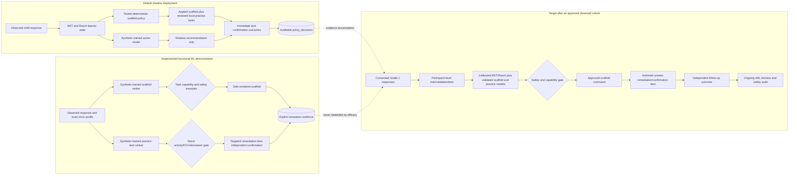

# Component 4 ML research pipeline

This implementation keeps the reviewed Skills 1–4 curriculum and deterministic
scaffolds as the production safety layer. Machine learning adds a second,
auditable decision-support layer; it does not generate Sinhala content or bypass
the authored remediation/confirmation state machine.

## Runtime flow

### New-learner cold start

Newly created children complete a separate **Starter Learning Profile** before
their first dashboard visit:

1. Two guided, unscored examples teach tap and sequence interactions.
2. Eight independent probes sample the four curriculum skills (two per skill).
3. The probe flow never calls C4 and never applies a scaffold, remediation, or
   confirmation task. It gives neutral feedback and displays no score.
4. Every response is immediately and idempotently stored in
   `baseline_item_events` with `data_origin=observed_baseline`,
   `research_role=baseline_probe`, and `calibration_eligible=false`.
   Choice positions are deterministically shuffled per learner, and the exact
   presented order is stored so position effects remain auditable.
5. A run is usable only with at least six valid responses and at least one from
   every skill. Otherwise it is retained as `insufficient` and C4 uses its
   normal defaults.
6. A usable run creates conservative, bounded mastery and Rasch starting
   values in `knowledge_states`; it never overwrites later learning evidence.
7. The median response-time ratio creates only a gentle 0.95–1.10 timing
   adjustment. Correctness remains the primary learning observation.
8. C4 records the profile version and timing factor with later decisions, so
   the cold-start influence is auditable.

The profile is a personalization aid, not a diagnosis or efficacy result. It
is resumable and required before the first dashboard visit for students created
after this feature was introduced. A child may pause and return to student
selection, but cannot bypass an unfinished profile. The existing
parent-completed screening remains a separate workflow.

1. Flutter sends stable item/option IDs, attempts, timing, touch points, and the
   screen's supported scaffold actions to API port `8015`.
2. The gateway creates server-controlled provenance, builds a rolling
   current-session behavioral context, and accepts C3 probabilities only when
   they are explicitly observed and validated.
3. C4 on port `9017` updates BKT/IRT only from the first independent response.
4. On an incorrect ATTEMPT, the deterministic capability policy creates a
   baseline action from a copied state.
5. The action-outcome model scores only actions supported by that screen. A
   small instructional-cost penalty prefers replay/retry over answer-revealing
   help when their predicted benefit is similar.
6. In `shadow` mode the baseline is applied. In explicit
   `simulation_model` mode, the model recommendation is translated to stable,
   authored command/option IDs and applied. The translator protects targets,
   preserves two visible options, and safely falls back to retry when a model
   command cannot be rendered.
7. Skills 1 and 2 retain the core item's authored `V1`/`V2` fallback and a
   reviewed local exact-target pool (`V3+`). An incorrect core unit can select
   an easier remediation and an equivalent independent confirmation for that
   same image, letter, word, or sequence token.
8. The practice-item ranker is restricted to the failed core item's own
   equivalent group before model ranking. It never generates child-facing
   Sinhala content and never injects a remembered target into a later activity.
9. Scaffold selection, BKT/IRT updates, telemetry, and local targeted
   remediation/confirmation remain active. The removed feature is only the
   cross-activity target-memory/repetition experiment.
10. Each later response closes an **immediate (proximal) outcome** for the most
   recent scaffold. When independent confirmation is completed, its
   first-attempt result is linked to the support chain. The scaffolded click
   itself is never labelled as proof of learning; abandoned chains remain
   unlinked/censored.
11. Parent and specialist dashboards read the same stored evidence. The parent
   dashboard shows the latest session **for each attempted activity** across
   Skills 1–4 and counts distinct sessions rather than database rows. Starting
   a new activity therefore does not hide earlier completed activities. Parents get
   plain summaries; specialists get candidate scores, applied-vs-recommended
   action, immediate and confirmation outcomes, BKT/IRT state, C3 pipeline
   status, provenance, and limitations.

If C3 lacks its required matched speech, kinematic, demographic, or provenance
inputs, it is explicitly reported as `skipped_missing_inputs`. Missing child
measurements are not filled with synthetic values and synthetic-only C3 output
cannot control C4.

## Policy modes

- `baseline`: deterministic policy only.
- `shadow` (default): the model ranks alternatives and stores evidence while
  the deterministic policy controls the game.
- `simulation_model`: the included synthetic-trained model controls scaffold
  choice for a clearly labelled functional demonstration. Raw child events
  remain `observed`; the policy evidence separately says
  `execution_source=synthetic_model_simulation`. This is not efficacy evidence.
- `simulation_experiment`: stable SHA-256 50/50 assignment by learner/session
  to baseline rules or model simulation. Assignment probability and arm are
  stored for reproducible baseline-versus-model analysis.
- `model`: control is allowed only for a registered
  `pilot_approved`/`validated_observed` artifact.

Set the mode on the **API gateway (port 8015)** because it is the service that
creates the server-controlled C4 request. C4 on port 9017 may also use the
variable as a default for direct research requests:

```bash
export C4_POLICY_MODE=simulation_model
python main.py
```

Check the gateway is forwarding the intended mode:

```bash
curl http://127.0.0.1:8015/health
# c4_policy_mode_forwarded should be simulation_model

curl http://127.0.0.1:9017/health
# shows the model version, validation status and accepted policy modes
```

Run the read-only offline acceptance check to see four different task-family
decisions and their exact rendered commands:

```bash
cd app/backend/adaptive-tutoring-v1
source venv/bin/activate
python research/verify_component4_system.py
```

## Scaffold action space

The candidate set is built per task. Unsupported actions cannot be selected.

| Task capability | Executed support |
|---|---|
| `REMOVE_OPTION` | Remove one known distractor and reflow the answer pool |
| `DISABLE_OPTION` | Lock a distractor in place for spatial-memory tasks |
| `HIGHLIGHT_OPTION` | Guide attention to the correct target |
| `HIGHLIGHT_DESTINATION` | Glow the correct sorting destination |
| `REPLAY_INSTRUCTION` | Replay the exact current prompt |
| `SLOW_AUDIO` | Replay at 0.78× speed after replay/hesitation evidence; it has its own fitted action model |
| `REVEAL_FIRST_TOKEN` | Reveal the next unresolved sequence token |

Correct-prefix locking is a deterministic safety invariant in sequence tasks,
not an ML treatment. Once the child has built a correct prefix, the UI keeps it
fixed and the model may support only the next unresolved token. Similarly,
fatigue never makes the model terminate a Grade-1 task: a one-minute optional
calm-break card is shown only after the activity is safely completed.

Every applied action, model score, utility, assignment arm, fallback, command,
immediate next response and independent confirmation outcome is stored.

## Data separation

Every research row uses `data_origin`, `dataset_id`, `validation_status`, and
`calibration_eligible`. Synthetic/public-external rows are always
calibration-ineligible. Newly collected app rows are also ineligible until
reviewed.

## Reproduce the synthetic action model

Run from the repository root. The API environment is used because it already
contains scikit-learn; C4 runtime reads plain JSON and does not need it.

```bash
app/backend/api/venv/bin/python \
  app/backend/adaptive-tutoring-v1/research/generate_synthetic_action_data.py \
  --output /tmp/c4_synthetic_action_data.csv \
  --learners 600 --interactions 24 --seed 26031

app/backend/api/venv/bin/python \
  app/backend/adaptive-tutoring-v1/research/train_action_model.py \
  --input /tmp/c4_synthetic_action_data.csv \
  --output app/backend/adaptive-tutoring-v1/models/c4_action_outcome_v1.json \
  --seed 26031
```

The trainer compares a class-prior baseline, logistic regression, random
forest, and histogram gradient boosting on a learner-group held-out split. It
also estimates policy value with self-normalized inverse propensity weighting.
All resulting claims remain labelled simulation evidence.

## Public-data adapter

The adapter accepts a locally obtained ASSISTments/EdNet-style CSV:

```bash
python app/backend/adaptive-tutoring-v1/research/import_public_kt.py \
  --input /path/to/public.csv \
  --output /tmp/public_kt_normalized.csv \
  --dataset-id assistments-release-id \
  --source-name ASSISTments
```

Public skills/items remain external-domain benchmark identifiers. They are not
renamed as Sinhala knowledge components and cannot calibrate the Sipsara bank.

## Near-real-time simulation

With C4 running on `9017`:

```bash
python app/backend/adaptive-tutoring-v1/research/replay_near_realtime.py \
  --input /tmp/c4_synthetic_action_data.csv --limit 20 --interval 0.25
```

## Observed-data calibration gate

After consent, data-quality review, participant-level splitting, and sufficient
coverage, preview approval:

```bash
python app/backend/adaptive-tutoring-v1/research/approve_observed_cohort.py \
  --dataset-id live-cohort-id --approved-by reviewer-name
```

Only after reviewing the dry-run count should `--apply` be added. Then run
`calibrate_item_bank.py` without `--apply`; apply calibration only if the
predeclared evidence requirements are met.

Run a read-only database integrity audit at any time:

```bash
python app/backend/adaptive-tutoring-v1/research/audit_research_database.py
```

For policy rows collected before action-outcome linkage was introduced, preview
an evidence-only repair and then explicitly apply it. The utility links only
stored later responses and stored V2 confirmations; it does not fabricate rows:

```bash
python app/backend/adaptive-tutoring-v1/research/backfill_policy_outcomes.py \
  --student-id STUDENT_ID --session-id SESSION_ID

python app/backend/adaptive-tutoring-v1/research/backfill_policy_outcomes.py \
  --student-id STUDENT_ID --session-id SESSION_ID --apply
```

## Meaning of the included model

The v2 artifact was trained on 14,400 deterministic synthetic rows from 600
simulated learners. Its held-out results show that the software pipeline can
compare action-outcome models. They do **not** show that a scaffold improves
learning for Grade 1 children, so the model is correctly blocked from automatic
live control.

## Current versus validated target



The visible scaffold can still be remove/highlight when that is the best safe
action supported by a screen. Audio, sorting, memory and sequence families now
also expose distinct replay, slow-audio, destination highlighting, spatial
disable and next-token behaviors where the UI really implements them.
The model does not advertise local correct-prefix locking or mid-task pause as
independent actions because those are safety/experience rules, not competing
treatments.

Synthetic data may train and test the software pipeline, but it must never be
relabeled as observed child data. Activation requires a registered model that
passes the observed-cohort approval gate and an educator-reviewed command
translator for every action it may apply.

## Dynamic remediation and confirmation

The scaffold action model and the practice-item model solve different
problems:

| Decision | Model input | Output | Safety boundary |
|---|---|---|---|
| Immediate scaffold | Attempts, timing, errors, mastery, fatigue and screen capabilities | One supported UI command such as replay, remove, reveal or destination highlighting | The Flutter screen advertises and safely renders the command |
| Next practice item | Diagnosed target, components, error tags, difficulty, exposure, micro-mastery and fatigue | One reviewed remediation or confirmation item | Same failed-core equivalent group first, then exact target and reviewed load; same activity/KC, correct role, active, unseen and non-duplicate |

The practice selector artifact is
`models/c4_practice_selector_v1.json`. Its logistic model was trained on a
learner-group split of explicitly synthetic data. The artifact is usable for
the functional `simulation_model` demonstration but remains blocked from
ordinary observed-child control.

Skills 1 and 2 contain reviewed local exact-target variants in addition to the
general `V1`/`V2` fallback. The bank currently contains 126 such variants for
Skill 1 and 94 for Skill 2. Each target has a remediation/confirmation pair,
both remain in the originating core item's equivalent group, and confirmation
changes answer placement where the screen supports it.

Candidate safety is explicit and auditable: selection prefers the failed core
group plus the diagnosed target; remediation uses the nearest reviewed lower
load and confirmation restores the core load. If precise ATTEMPT evidence is
unavailable, the system can safely fall back to the authored `V1`/`V2` pair.
No struggled image, letter, word, or sentence is carried into a later activity.

Reproduce the practice model:

```bash
app/backend/adaptive-tutoring-v1/venv/bin/python \
  app/backend/adaptive-tutoring-v1/research/generate_synthetic_practice_data.py \
  --output /tmp/c4_synthetic_practice_data.csv \
  --learners 500 --decisions 20 --seed 26031

app/backend/adaptive-tutoring-v1/venv/bin/python \
  app/backend/adaptive-tutoring-v1/research/train_practice_selector.py \
  --input /tmp/c4_synthetic_practice_data.csv \
  --output app/backend/adaptive-tutoring-v1/models/c4_practice_selector_v1.json \
  --seed 26031
```

The offline verifier reports scaffold action selection and practice selection
separately. It checks all 220 Skill 1-2 exact-target variants, same-group scope,
remediation/confirmation availability and difficulty constraints, while also
reporting that cross-activity target memory is disabled.
